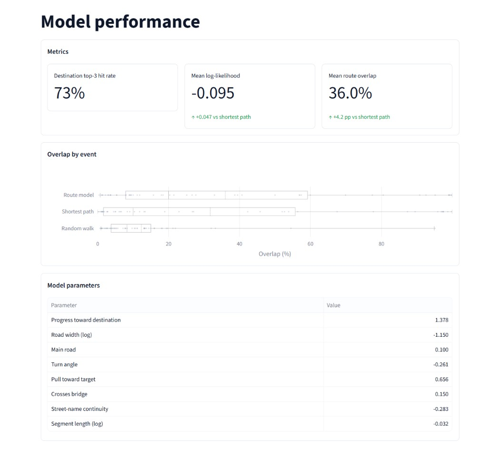
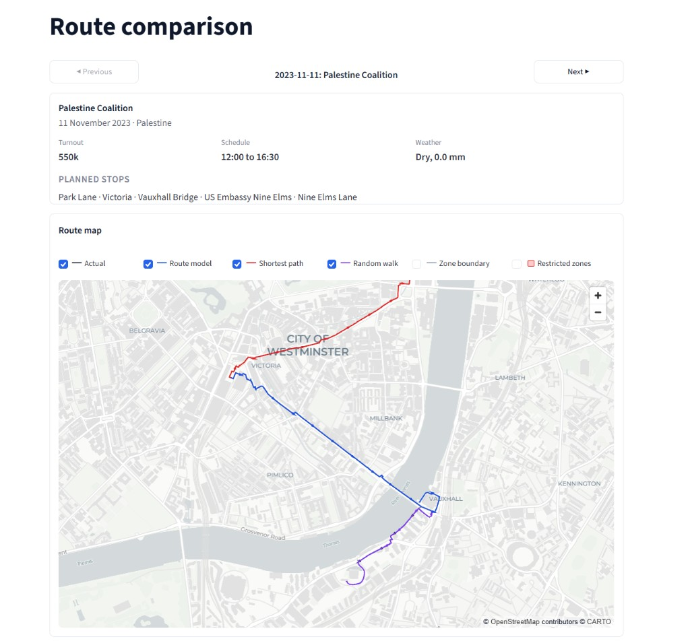

# London Protest Predictor — OxHack 2026

Ingestion, DuckDB, conditional logit training, and Streamlit backtests for London march routes. Setup: [README](README.md). Data: [docs/data-sources.md](docs/data-sources.md).

## Tagline

**Street-choice patterns from published march plans, scored against simple baselines.**

## The problem

London has a large protest most weekends. Routes are planned ahead but often announced late or only partly described. We fit a route model to **public march plans** on the walk network and compare it to a shortest-path planner’s guess.

## What it does

After `python ingest.py` and `python -m src.models.train`:

| Page | Output |
| --- | --- |
| **Model performance** | Leave-one-event-out backtest: mean step log-likelihood, route overlap (Jaccard), destination top-3 rate; overlap-by-event chart; fitted logit parameters |
| **Route comparison** | Map for one held-out event: actual route, model rollout, shortest-path and random-walk baselines; optional zone boundary and restricted-activity overlays; per-model metrics |

`lpp-ingest` writes `candidates.csv` for human review. Training uses committed seed files only (`ingest.py` does not read crawler output).

## The data

| Input | Role |
| --- | --- |
| Seed CSVs (65 events, hand reviewed) | Labels: events, waypoints, causes, provenance |
| OpenStreetMap (OSMnx) | Walk and main-road networks inside TfL zones 1–2 |
| Overpass landmarks | Protest targets and open spaces (cause targets, Royal Park flags) |
| TfL API | Zones 1–2 boundary |
| Open-Meteo | Hourly precipitation around each event date (`event_context`; map captions) |
| Derived processing | Edge features, cause targets, route segment labels |

See [docs/data-sources.md](docs/data-sources.md) and [docs/crawler.md](docs/crawler.md).

## How the route model works

At each junction the model picks the next street with a **conditional logit** (softmax over feasible successors on the walk graph):

$$
P(b \mid a) = \frac{\exp(\theta^\top x(a,b))}{\sum_{b' \in N(a)} \exp(\theta^\top x(a,b'))}
$$

**Eight features** in `src/models/features.py`: network progress toward the destination, log width, main road, turn angle, pull toward cause targets, Thames bridge, street-name continuity, log segment length. Weights are fit by weighted maximum likelihood (L-BFGS) with regularisation toward stated priors. Published waypoint segments count at weight 1.0; shortest-path interpolation between waypoints counts at 0.3.

No-entry segments are dropped when the graph is built. Restricted-activity zones are **map overlays only**, not logit features.

**Destinations** for rollout and the shortest-path baseline combine cause targets and historical end points for the same cause (`src/models/destinations.py`). The backtest reports how often the true destination is in the top three candidates.

## How we test it

Training runs a **leave-one-event-out** backtest (events ordered in time). For each held-out march:

- **Route model** — greedy rollout using the fitted logit  
- **Shortest path** — shortest walk to a chosen destination  
- **Random walk** — uniform choice among successors  

Results go to `data/models/backtest.json` (UI) and per-event paths for the route map. Training warns if the route model does not beat shortest path on mean log-likelihood.

## How we built it

Four teammates: ingestion, route model, UI, and shared seed review. Pipeline: public sources and seed routes → `ingest.py` → `python -m src.models.train` → `streamlit run app.py`.

**Stack:** Python 3.12, DuckDB 1.5 (spatial), OSMnx, NetworkX, SciPy, pydeck, Plotly, Streamlit, pytest, ruff, GitHub Actions.

## Challenges

- Reliable labels from published plans and reviewed geocodes, not crowd GPS  
- Uneven history across causes; a small regularised feature set  
- Choice sets must respect the walk network and legal no-entry segments  

## What we learned

Joining public sources on one street graph and reporting performance against simple baselines matter as much as the estimator.

## What's next

- Grow the seed set via reviewed promotion from `lpp-ingest`  
- Pull organiser and police notices into the crawler, still behind human geocode review  
- Richer destination and rollout evaluation as more events are added  
