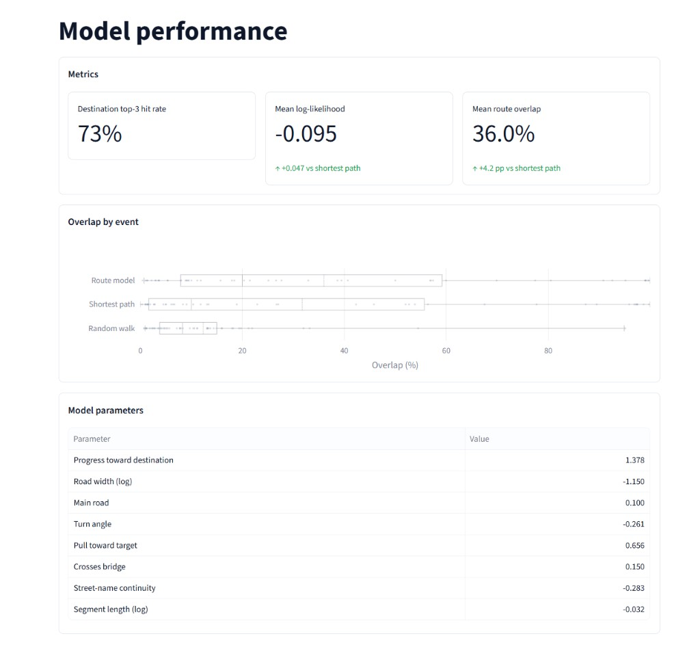
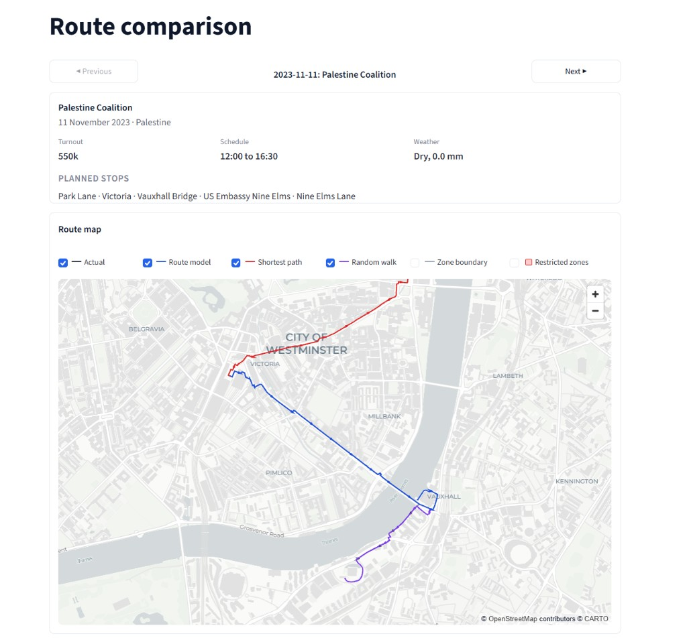
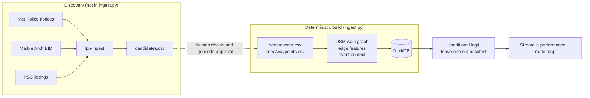

# London Protest Predictor


Predicts march routes on the London walk network from published march plans and OpenStreetMap, then scores the model with a leave-one-event-out backtest against shortest-path and random-walk baselines.

London has a large protest most weekends; routes are often announced late or only partly described. This project fits a conditional logit model of street choice to 65 hand-reviewed historical march plans and surfaces the results in two Streamlit pages.

OxHack 2026 — see [Contributors](#contributors).





## Tech stack

- Python 3.12, DuckDB 1.5 with the spatial extension, OSMnx, NetworkX
- SciPy (L-BFGS conditional logit), pydeck, Plotly, Streamlit
- pytest, ruff, GitHub Actions CI

## Architecture



## Repository map

```
app.py, ingest.py          # Streamlit app and one-shot ingestion orchestrator
src/ingestion/             # Crawler + route-research pipeline (seed → normalised artefacts)
src/models/                  # Conditional logit training and backtest
src/database/                # DuckDB load and query helpers
src/ui/                      # Streamlit pages (model performance, route comparison)
src/ingestion/route_research/seed/   # 65 hand-reviewed historical marches
tests/                       # crawler and route_research test suites
docs/                        # data-sources.md, crawler.md, images/
```

## How to set up

Run these steps in order from the repo root.

| Step | Command | How often |
|---|---|---|
| 1. Python environment | `python3.12 -m venv .venv`, activate, `pip install -e ".[dev]"` | once |
| 2. Optional credentials | none required for the default build | — |
| 3. All ingestion + database | `python ingest.py` (with the app closed) | whenever you want fresh data |
| 4. Train the route model | `python -m src.models.train` | after each ingestion |
| 5. Tests | `pytest -q` | before pushing |
| 6. App | `streamlit run app.py` | |

Quick version, from a fresh clone:

```bash
python3.12 -m venv .venv && source .venv/bin/activate
pip install -e ".[dev]"
python ingest.py                     # data -> data/protest.duckdb
python -m src.models.train           # model -> data/models/
pytest -q
streamlit run app.py
```

### 1. Python environment

The repo pins Python 3.12 (`.python-version`).

```bash
python3.12 -m venv .venv
source .venv/bin/activate  # On Windows: .venv\Scripts\activate
pip install -e ".[dev]"
```

DuckDB's spatial extension comes with `pip install` (the `duckdb-extension-spatial` package) and is installed automatically the first time the database is opened. **Intel Macs** have no wheel for it: see [Spatial extension on Intel Macs](#spatial-extension-on-intel-macs).

### 2. Ingestion: one command

```bash
python ingest.py
```

This runs every step in dependency order:

| Step | What it does | Output |
|---|---|---|
| `boundary` | Zones 1-2 polygon from TfL station zones | `data/route_research/raw/boundary/` |
| `osm` | OSM walk network + main-road network inside the boundary | `data/route_research/raw/osm/` |
| `landmarks` | Protest targets and open spaces (cause targets, Royal Park zone flags) | `data/route_research/raw/landmarks/` |
| `seed-coords` | Waypoint coordinates from the reviewed geocode cache | `data/route_research/coordinate_review.csv` |
| `normalize` | Street segments, route labels, context tables | `data/route_research/normalised/` |
| `edge-features` | Per street: usable width, main-network betweenness, junction degree, legal-zone and Royal Park flags | `data/route_research/normalised/edge_features.csv` |
| `weather` | Hourly Open-Meteo precipitation around each event date | `data/route_research/raw/weather/` |
| `event-context` | Per-event cause, precipitation and daylight (route map metadata) | `data/route_research/normalised/event_context.csv` |
| `cause-targets` | Where each cause marches to (`seed/cause_targets.csv`), embassies located from the data, checked against the seed routes | `data/route_research/normalised/cause_targets.csv` |
| `database` | Loads all of the above into DuckDB (see [Database](#database)) | `data/protest.duckdb` |

Useful options:

```bash
python ingest.py --list                       # steps and their dependencies
python ingest.py --only weather event-context # run just these
python ingest.py --refresh                    # redo cached steps (boundary, osm, landmarks, edge-features)
python ingest.py --refresh osm                # re-download just one of them
```

- The first run is slow: the OSM network and landmarks for zones 1-2 take several minutes each. Later runs skip downloads whose files already exist.
- All 65 seed routes are always used for training.
- Landmarks retry busy Overpass servers with backoff across three mirrors. If a layer still fails, re-run `python ingest.py --only landmarks` and only the missing layers are fetched.
- If a step fails, the steps that depend on it are skipped, the rest still run, and a summary is printed at the end. Re-run a failed step with `--only <step>`.
- Every step can also be run on its own via `src/ingestion/route_research/` modules; see `src/ingestion/README.md` and `ingest.py --list`.

### 3. Train the route model

```bash
python -m src.models.train           # full leave-one-event-out backtest
python -m src.models.train --quick   # five-event smoke test
```

Training reads `data/protest.duckdb` read-only and writes `data/models/graph.pkl`, `route_model.json` and
`backtest.json`. It prints the backtest against the shortest-path and random-walk baselines, and warns if the
route model doesn't beat shortest path. Re-train after every ingestion. Add `--force-graph` to rebuild the
street graph. See `src/models/README.md`.

### 4. Run tests

```bash
pytest -q
pytest --cov=src --cov-report=term-missing   # optional local coverage
```

The same suite runs in CI on every push and pull request.

### 5. Run the app

```bash
streamlit run app.py
```

- **Model performance** — charts, coefficient table, and per-event metrics from `data/models/backtest.json`.
- **Route comparison** — pydeck map of actual vs leave-one-out model paths (DuckDB optional for zones boundary overlays and event context captions).
- Close the app before re-running `python ingest.py`: it holds the database open.

## Database

`data/protest.duckdb` is the single store that the app and training read from. It's rebuilt from the ingestion files by the `database` step (or on its own with `python -m src.database.load`). **Close the Streamlit app first:** it holds the file open and the loader will say so.

| Group | Tables |
|---|---|
| Map | `boundary`, `segments` (walk network with `n_published_route_examples` and `edge_features`: `width_m`, `betweenness_main`, `to_degree`, `is_main`, `in_*_zone`), `targets` (embassies have an ISO `country` code), `legal_zones` (no-entry sites, Parliament Square controlled area, Royal Parks from seed + OSM) |
| Events and routes | `events`, `waypoints`, `route_segments` (ordered `segment_id`s per `event_id`), `event_context`, `cause_targets` |
| Bookkeeping | `load_log` (rows and load time per table) |

## Contributors

- [@crislu05](https://github.com/crislu05)
- [@Jakub-Kisielewski](https://github.com/Jakub-Kisielewski)
- [@MykhailoKopytskyi](https://github.com/MykhailoKopytskyi)

## Licence

Released under the [MIT License](LICENSE).

## Data sources

- [docs/data-sources.md](docs/data-sources.md) — APIs and seed provenance (65 events by source)
- [docs/crawler.md](docs/crawler.md) — `lpp-ingest` platforms and output
